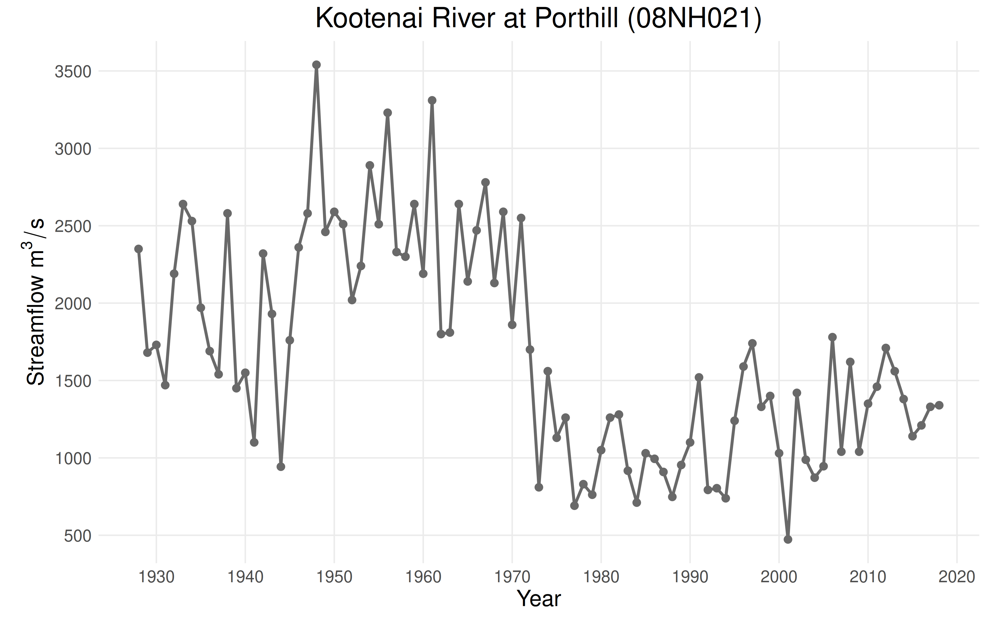
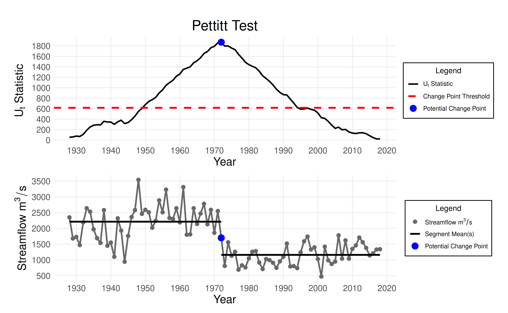
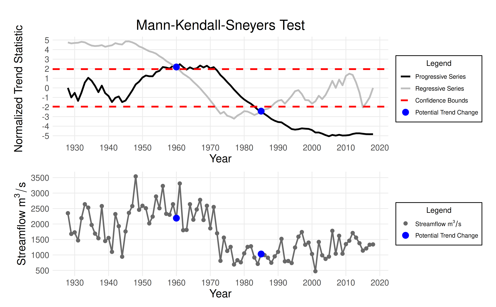

# Change Point Detection

A change point is an abrupt shift or a temporal pattern switch (e.g.,
beginning of a trend) in a time series. In FFA, change points indicate
inhomogeneous periods, meaning a single model may not represent the
entire record adequately. Instead, piecewise analysis should be applied
to each homogeneous sub-period. The FFA framework provides two
statistical tests for change point detection:

- The Pettitt test, for sudden changes in the mean.
- The Mann-Kendall-Sneyers (MKS) test, for detecting changes in trend.

This vignette will demonstrate how these statistical tests can be used
together to robustly identify change points.

## Case Study

This vignette will explore the Kootenai River at Porthill (08NH021)
station, located on the border of British Columbia and Idaho. The
station is located downstream of the Libby Dam, which finished
construction in 1972. Data for this station is provided as
`CAN-08NH021.csv` in the `ffaframework` package.

``` r

library(ffaframework)

df <- data_local("CAN-08NH021.csv")
head(df)
#>   year  max
#> 1 1928 2350
#> 2 1929 1680
#> 3 1930 1730
#> 4 1931 1470
#> 5 1932 2190
#> 6 1933 2640

plot_ams_data(df$max, df$year, title = "Kootenai River at Porthill (08NH021)")
```



## The Pettitt Test

This rank-based test detects a single abrupt change in the median of a
time series. The null hypothesis assumes no change point. Use the
`eda_pettitt_test` function to perform the test. It requires two
arguments:

- `data`: the annual maximum series (AMS)
- `years`: corresponding numeric vector of years

``` r

pettitt_test <- eda_pettitt_test(df$max, df$year)

print(pettitt_test$p_value)
#> [1] 0

print(pettitt_test$change_year)
#> NULL

plot_pettitt_test(pettitt_test)
```



**Conclusion**: A p-value of \<0.001 provides strong evidence of a
change point in the year 1972.

## The MKS Test

The Mann-Kendall-Sneyers (MKS) test identifies trend changes in the
data.

Use `eda_mks_test` with the same arguments as above.

``` r

mks_test <- eda_mks_test(df$max, df$year)

print(mks_test$p_value)
#> [1] 0.01495225

print(mks_test$change_df$year)
#> NULL

plot_mks_test(mks_test)
```



**Conclusion**: At a p-value of 0.015, there is evidence of trend
changes in 1960 and 1985.

**Note**: Since the MKS test can identify multiple change points, the
reported p-value is determined using the *most significant* change
point.

## Interpreting and Selecting Change Points

In this example, the Pettitt and MKS tests both suggest structural
changes in the time series.

Consider the following guidelines when choosing where to split the data:

1.  **Incorporate domain knowledge and case-specific understanding**. In
    this example, we know that a water regulation structure was built in
    1972 (the Libby dam). This supports the results of the Pettitt test.
2.  **Avoid overpartitioning**. The Pettitt and MKS tests operate
    independently and may detect multiple change points. To minimize
    sample size issues and reduce uncertainty, retain only significant
    change points with physical justification.
3.  **Prioritize based on p-value**. Lower p-values indicate stronger
    evidence and should be given more weight.
