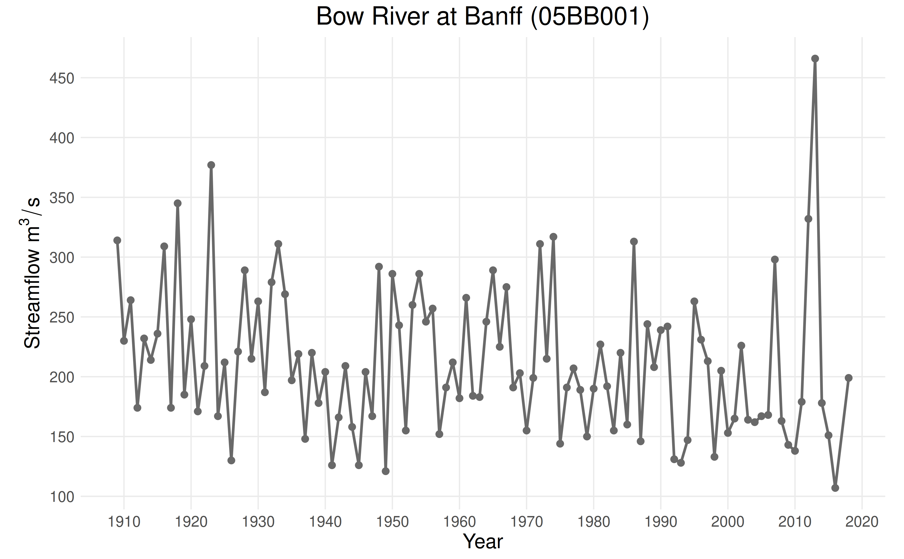
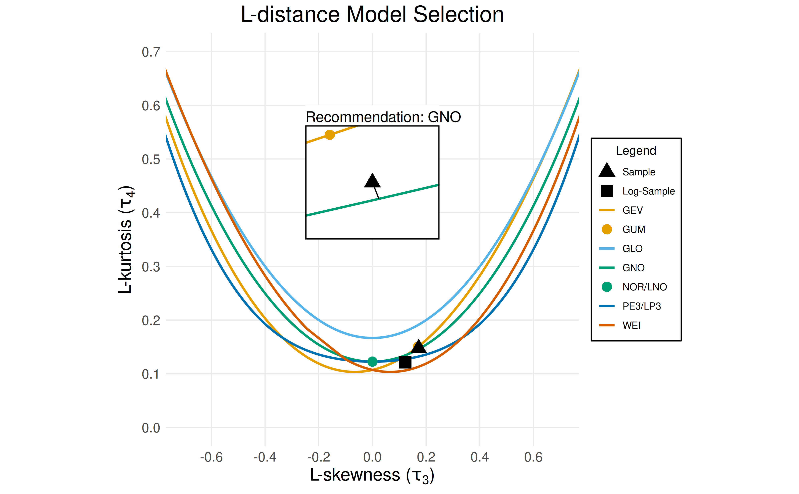
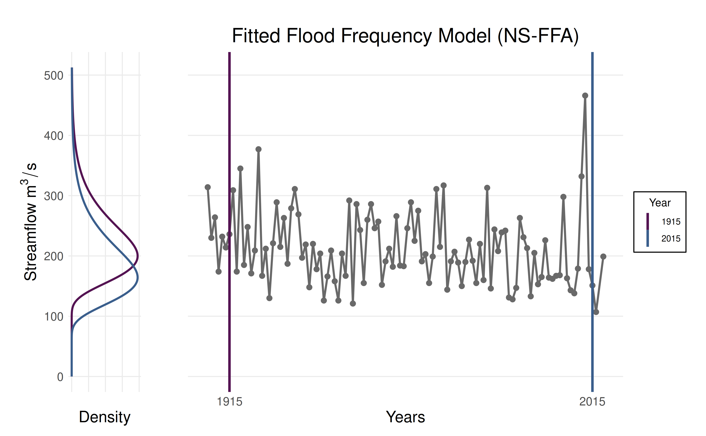
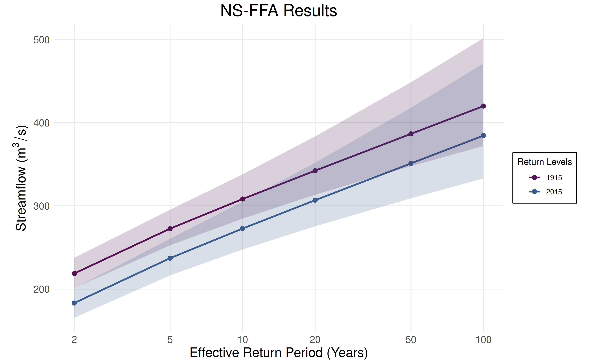
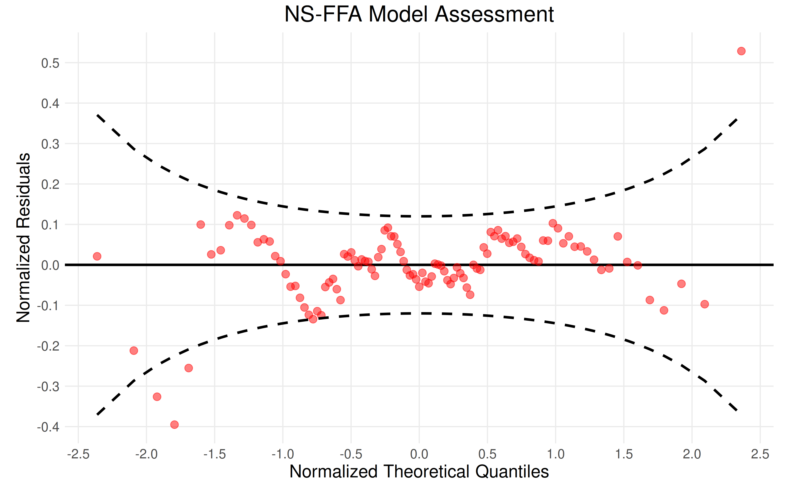

# Nonstationary FFA

This vignette demonstrates how to use the `ffaframework` package to
perform flood frequency analysis under the assumption of nonstationarity
(NS-FFA). Readers unfamiliar with stationary FFA workflows should first
consult the *Stationary FFA* vignette.

The framework supports three forms of nonstationarity, modeled as linear
trends in the distribution parameters:

1.  A linear trend in the location parameter.
2.  A linear trend in the scale parameter.
3.  A linear trend in both the location and scale parameters.

The shape parameter is treated as a constant due to difficulties in
estimation caused by sample size limitations.

## Case Study

This vignette will explore data from the Bow River at Banff (05BB001), a
station in the Reference Hydrometric Basin Network. The station is
unregulated, which suggests that trends in annual maxima are caused by
changes in climate as opposed to changes in land use or cover. Data for
this station is provided as `CAN-05BB001.csv` in the `ffaframework`
package.

``` r

library(ffaframework)

df <- data_local("CAN-05BB001.csv")
head(df)
#>   year max
#> 1 1909 314
#> 2 1910 230
#> 3 1911 264
#> 4 1912 174
#> 5 1913 232
#> 6 1914 214

plot_ams_data(df$max, df$year, title = "Bow River at Banff (05BB001)")
```



### The `ns_structure` List

This vignette assumes a scenario where a trend in the mean has been
identified. To specify a trend in one or more distribution parameters,
create a `ns_structure` (nonstationary model structure) list containing
the boolean items `location` and `scale`. Setting these items to `TRUE`
adds a trend to the location/scale parameter respectively.

``` r

ns_structure <- list(location = TRUE, scale = FALSE)
```

**Note**: For guidance on trend detection, refer to the *Trend
Identification* vignette.

## Distribution Selection

L-moment-based distribution selection remains applicable under
nonstationarity, but requires dataset decomposition (detrending) prior
to analysis. The `select_*` methods do this automatically (using the
`data_decomposition` method) if the `ns_years` and `ns_structure`
arguments are supplied.

``` r

selection <- select_ldistance(
    df$max,
    ns_years = df$year,
    ns_structure = ns_structure
)

print(selection$recommendation)
#> [1] "GNO"

plot_lmom_diagram(selection)
```



**Note**: The sample and log-sample points on the L-moment diagram are
based on the detrended data.

**Conclusion**: The generalized normal (GNO) distribution is the
best-fit distribution for the sample.

## Parameter Estimation

Because L-moments parameter estimation requires stationarity, we will
use maximum likelihood estimation for this nonstationary model. The
`fit_mle` function implements maximum likelihood estimation for both
stationary and nonstationary distributions. It has two required
arguments:

- `data`: The annual maximum series observations.
- `model`: A three-letter code corresponding to a probability
  distribution (ex. `"GNO"`).

Since a nonstationary model is used, two additional arguments are
required:

- `ns_years`: The corresponding vector of years for the observations in
  `data`.
- `ns_structure`: The nonstationary `structure` object described above.

``` r

fit <- fit_mle(
    df$max,
    "GNO",
    ns_years = df$year,
    ns_structure = ns_structure
)

print(fit$params)
#> [1] 224.0496619 -35.5153685  54.6324886  -0.3689085

print(fit$mll)
#> [1] -590.7329

plot_nsffa_fit(fit, slices = c(1915, 2015))
```



**Note**: The fitted parameters are: \\(\mu_0, \mu_1, \sigma, \kappa)\\,
where the time-dependent location is modeled as \\\mu(t) = \mu_0 + \mu_1
t\\. The covariate \\t\\ is a linear function of the years:
\\(\text{years} - 1900) / 100\\.

## Uncertainty Quantification

Uncertainty quantification is an important step in NS-FFA as well as
S-FFA. In addition to the parametric bootstrap, the framework implements
the regula-falsi profile likelihood (RFPL) method for MLE. The
`uncertainty_rfpl` method has two required arguments:

- `data`: The annual maximum series observations.
- `model`: A three-letter code corresponding to a probability
  distribution (ex. `"GNO"`).

Since our model has a nonstationary structure, three additional
arguments are required:

- `ns_years`: The corresponding vector of years for the observations in
  `data`.
- `ns_structure`: The nonstationary `structure` object described above.
- `ns_slices`: The years at which return levels are computed.

``` r

uncertainty <- uncertainty_rfpl(
    df$max,
    "GNO",
    ns_years = df$year,
    ns_structure = ns_structure,
    ns_slices = c(1915, 2015)
)

plot_nsffa_estimates(uncertainty)
```



**Example Conclusion**: In 2025, there is a \\1/20\\ exceedance
probability of a flood of approximately \\300\text{m}^3/\text{s}\\ or
greater. The estimated return levels have decreased by approximately
\\50\text{m}^3/\text{s}\\ between 1925 and 2025.

**Note**: Under nonstationarity, the return period reflects the
probability distribution for a fixed year rather than a long-run
average. To clarify this difference from stationary FFA, the phrase
“effective return period” is used.

## Model Assessment

During S-FFA model assessment, we compare the data (or “empirical
quantiles”) with the predictions of the parametric model at the plotting
positions (the “theoretical quantiles”). Unfortunately, the same method
does not work for NS-FFA, since the method of plotting positions assumes
stationarity. However, if we normalize the data using our selected
distribution, we can remove the time-dependence and use the method of
plotting positions as in S-FFA. The `model_assessment` function will
make the necessary adjustments for NS-FFA automatically provided that
the `ns_years` and `ns_structure` arguments are provided.

``` r

assessment <- model_assessment(
    df$max,
    "GNO",
    "MLE",
    ns_years = df$year,
    ns_structure = ns_structure
)

plot_nsffa_assessment(assessment)
```



The model assessment plot shown above depicts the normalized theoretical
quantiles on the x-axis and the *difference* between the theoretical and
empirical quantiles on the y-axis. The dashed black lines are the 95%
confidence bounds. From this plot, we can see that the model is a
suitable fit for almost all data points.
