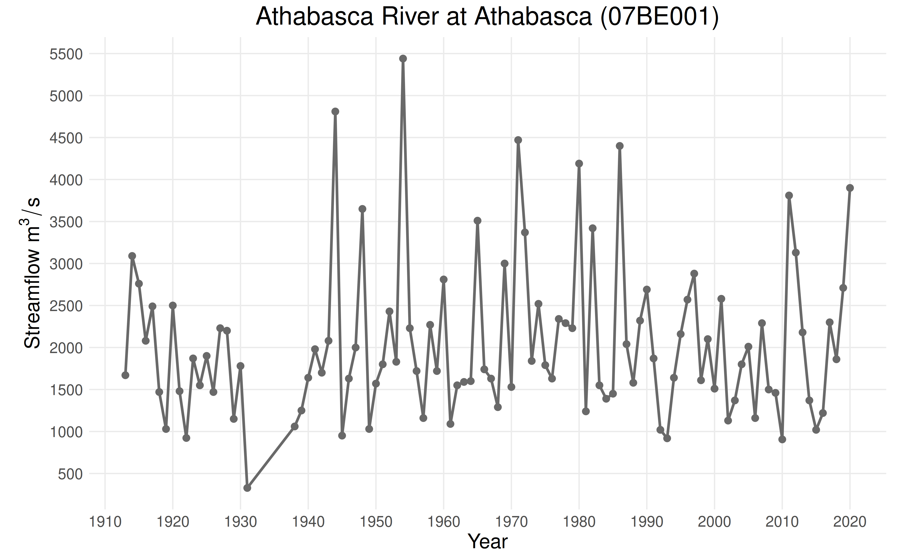
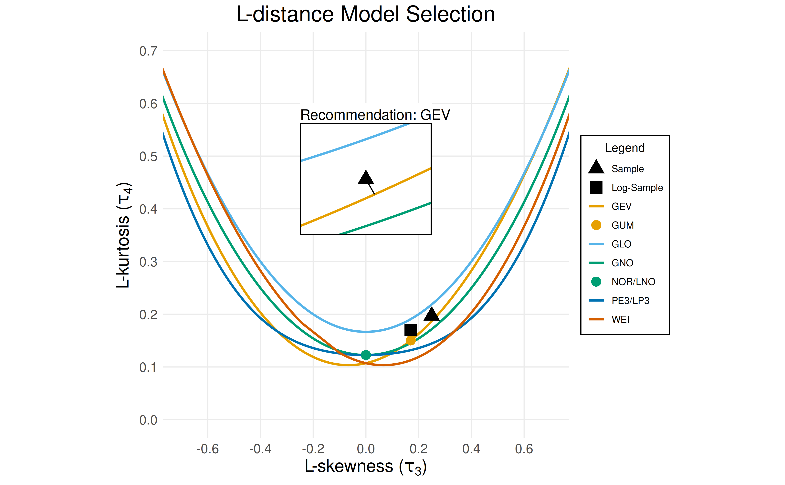
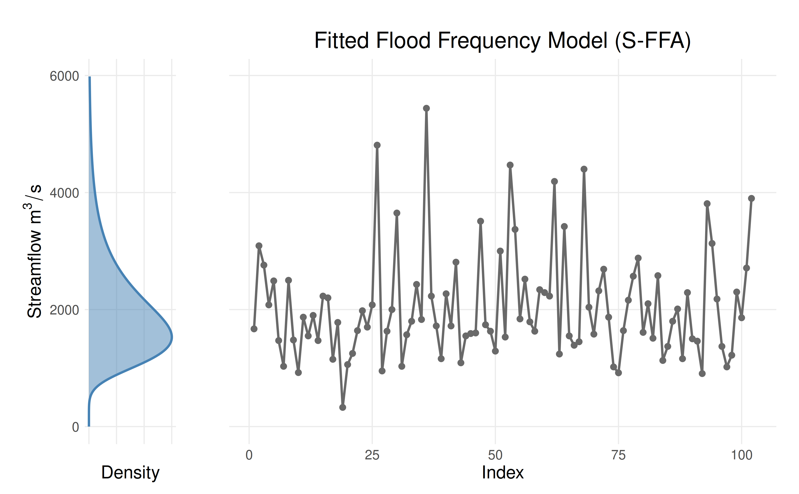
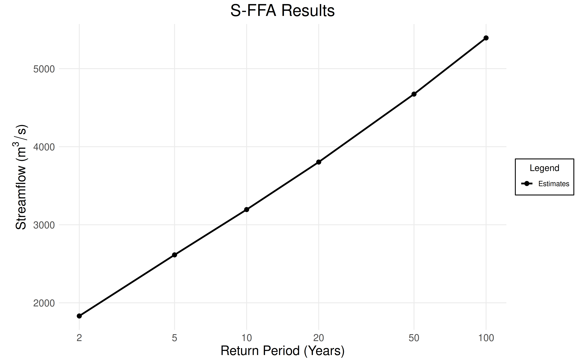
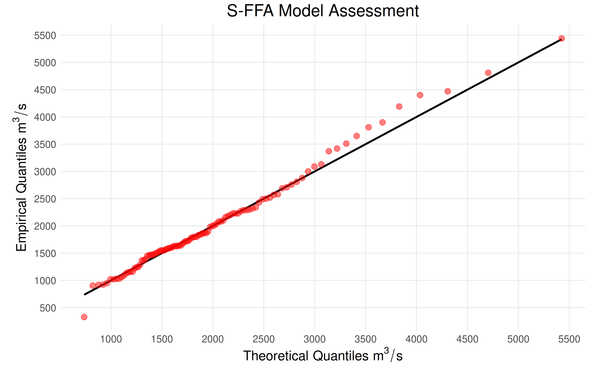

# Stationary FFA

This vignette demonstrates how to use the `ffaframework` package to
perform flood frequency analysis (model selection, parameter estimation,
uncertainty quantification, and model performance assessment) under the
assumption of stationarity.

The results are expressed in terms of *return periods* and *return
levels*. The *return period* of a flood is the expected number of years
between annual maximum events of equal or greater magnitude while the
*return level* is the magnitude of the annual maximum event, measured in
\\\text{m}^3/\text{s}\\.

## Case Study

This vignette will explore data from the Athabasca River at Athabasca
(07BE001), an unregulated hydrological monitoring station. A statistical
analysis of the data from this station does not reveal any evidence of
trends in the mean or variability of the data. Data for this station is
provided as `CAN-07BE001.csv` in the `ffaframework` package.

``` r

library(ffaframework)

df <- data_local("CAN-07BE001.csv")
head(df)
#>   year  max
#> 1 1913 1670
#> 2 1914 3090
#> 3 1915 2760
#> 4 1916 2080
#> 5 1917 2490
#> 6 1918 1470

plot_ams_data(df$max, df$year, title = "Athabasca River at Athabasca (07BE001)")
```



## Distribution Selection

First, a suitable probability distribution for the data is selected
using the L-moments.

1.  `select_ldistance` chooses the distribution with theoretical
    L-skewness (\\\tau_3\\) and L-kurtosis (\\\tau_4\\) closest to the
    sample, based on Euclidean distance.
2.  `select_lkurtosis` selects the distribution with the smallest
    difference between sample and theoretical L-kurtosis (for
    three-parameter distributions only).
3.  `select_zstatistic` uses a fitted 4-parameter Kappa distribution to
    estimate the sampling distribution of the L-kurtosis and selects the
    distribution with the smallest z-statistic.

``` r

selection <- select_ldistance(df$max)

print(selection$recommendation)
#> [1] "GEV"

plot_lmom_diagram(selection)
```



**Recommendation**: Use the generalized extreme value (GEV)
distribution.

**Note**: For information about the other distributions, see the
`selection$metrics` item.

You can find more information about the probability distributions
supported by the framework
[here](https://rileywheadon.github.io/ffa-framework/articles/probability-distributions.html).

## Parameter Estimation

The `ffaframework` package provides three methods for parameter
estimation. See
[here](https://rileywheadon.github.io/ffa-framework/articles/parameter-estimation.html)
for more information.

- `fit_lmoments`: L-moments parameter estimation.
- `fit_mle`: Maximum likelihood parameter estimation.
- `fit_gmle`: Generalized maximum likelihood parameter estimation.

``` r

fit <- fit_lmoments(df$max, "GEV")

print(fit$params)
#> [1] 1600.219872  616.666030    0.120747

plot_sffa_fit(fit)
```



**Conclusion**: The GEV distribution with `location = 1600`,
`scale = 616`, and `shape = 0.12` will be used.

## Uncertainty Quantification

Once a probability distribution is fitted, return levels (design events)
can be readily estimated. However, point estimates alone can be
misleading –it is more informative to report confidence intervals to
reflect estimation uncertainty. The `uncertainty_bootstrap` function
performs uncertainty quantification using the parametric bootstrap
method. It requires three arguments:

- `data`: A vector of annual maximum series data.
- `model`: A three-letter code for a probability distribution (ex.
  `"GEV"`).
- `method`: A parameter estimation method. Must be `"L-moments"`,
  `"MLE"`, or `"GMLE"`.

By default, return levels are computed 2-, 5-, 10-, 20-, 50-, and 100-
year return periods.

``` r

uncertainty <- uncertainty_bootstrap(df$max, "GEV", "L-moments")

plot_sffa_estimates(fit, ci = uncertainty$ci)
```



**Example Conclusion**: Every 10 years, we can expect a flood of roughly
\\3{\small,}200\text{m}^3/\text{s}\\ or greater.

## Model Assessment

Model performance is assessed using `model_assessment`, which reports a
collection of assessment statistics about the flood frequency analysis.
`plot_sffa_assessment` compares the data (the “empirical quantiles”) and
the predictions of the parametric model at the plotting positions (the
“theoretical quantiles”). The black line represents a perfect 1:1
correspondence between the model and the data.

``` r

assessment <- model_assessment(df$max, "GEV", "L-moments")

plot_sffa_assessment(assessment)
```



**Conclusion**: The parametric model generally matches the plotting
positions. The model slightly underestimates the data from
\\3{\small,}500\text{m}^3/\text{s}\\ to
\\5{\small,}000\text{m}^3/\text{s}\\.
