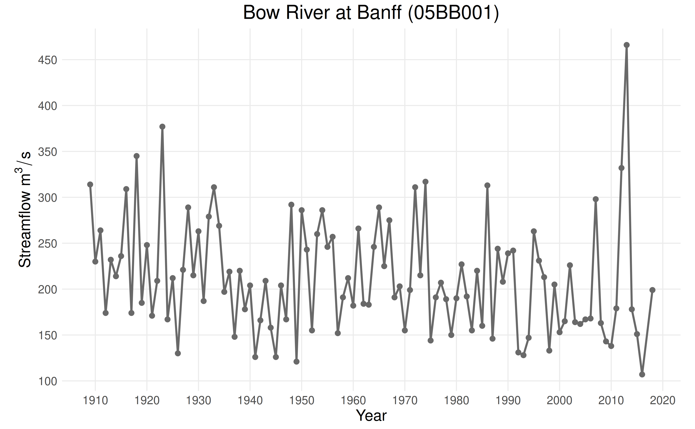
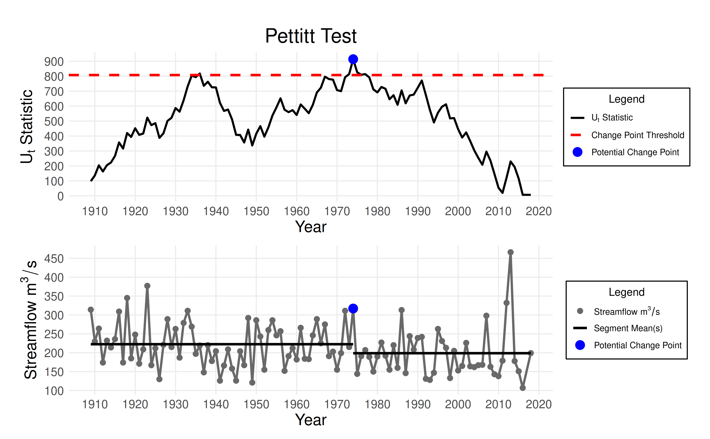
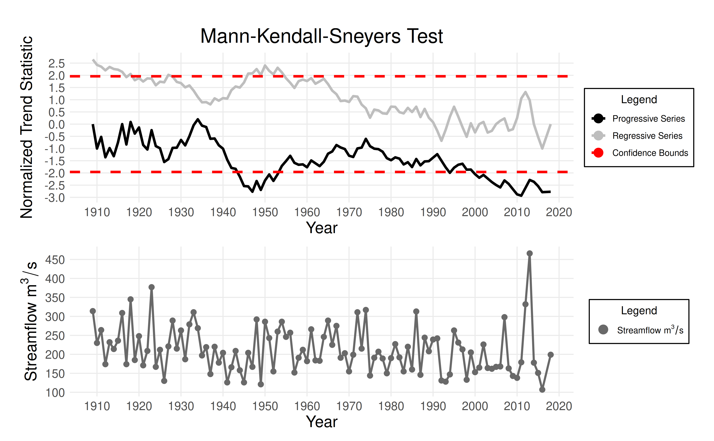

# Using Wrapper Functions for Framework Orchestration

This vignette demonstrates how to use the high-level wrapper functions
`framework_eda`, `framework_ffa`, and `framework_full` to perform a
complete flood frequency analysis of a dataset under the assumption of
nonstationarity. Readers unfamiliar with the FFA framework should first
consult the other vignettes.

## Case Study

This vignette will explore data from the Bow River at Banff (05BB001), a
station in the Reference Hydrometric Basin Network. The station is
unregulated and undeveloped, which suggests that trends in annual maxima
are caused by changes in climate as opposed to changes in land use or
cover. Data for this station is provided as `CAN-05BB001.csv` in the
`ffaframework` package.

``` r

library(ffaframework)

df <- data_local("CAN-05BB001.csv")
head(df)
#>   year max
#> 1 1909 314
#> 2 1910 230
#> 3 1911 264
#> 4 1912 174
#> 5 1913 232
#> 6 1914 214

plot_ams_data(df$max, df$year, title = "Bow River at Banff (05BB001)")
```



## Exploratory Data Analysis with `framework_eda`

Exploratory data analysis, the first module in the FFA framework,
identifies change points and nonstationary trends in the data. The
entire module is orchestrated by the `framework_eda` wrapper function,
which takes the following arguments:

- `data`: The annual maximum series observations.
- `years`: The corresponding vector of years.
- `ns_splits`: A list of years used to split the data prior to trend
  detection.
- `generate_report`: If `TRUE`, a report will be generated based on
  `report_path` and `report_formats`.
- `report_path`: The directory where the report will be saved.
- `report_formats`: A list of file formats (`"md"`, `"pdf"`, `"json"`,
  or `"html"`) for the report.

The `framework_eda` function also returns a list of recommendations,
including an approach (either S-FFA, NS-FFA, or piecewise NS-FFA), a
list of split points, and a list of nonstationary structures.

``` r

results <- framework_eda(df$max, df$year, generate_report = FALSE)

print(results$eda_recommendations)
#> $approach
#> [1] "Piecewise NS-FFA"
#> 
#> $ns_splits
#> [1] 1974
#> 
#> $ns_structures
#> $ns_structures[[1]]
#> $ns_structures[[1]]$location
#> [1] TRUE
#> 
#> $ns_structures[[1]]$scale
#> [1] FALSE
```

From the `eda_recommendations` item, we can see that the FFA framework
recommends a split point in 1974. Since we did not use the `ns_splits`
argument, trend detection was run on the complete time series. A
monotonic trend in the location was identified over this period.

### Selecting Split Point(s)

The change point detection vignette discussed multiple criteria for
selecting a split point. The first and most important criteria is that
there is a physical justification for the split point. For this case
study, there is no physical justification for a split point since the
basin is unregulated.

However, in cases where we have less information, it is often useful to
investigate the results of the Pettitt and MKS tests more carefully. The
`framework_eda` function allows us to do this by (a) reading the report,
or (b) using the `submodule_results` object. The `submodule_results`
object is a list with two elements: the results of change point
detection and the results of trend detection.

``` r

pettitt_results <- results$submodule_results[[1]]$tests$pettitt
mks_results <- results$submodule_results[[1]]$tests$mks

plot_pettitt_test(pettitt_results)
```



``` r

plot_mks_test(mks_results)
```



From these plots, we can see that the change point in 1974 was
identified by the Pettitt test, and that this change point is barely
above the significance threshold.

## Flood Frequency Analysis with `framework_full`

Using the results of EDA and our knowledge of the station, it is clear
that a nonstationary approach with no split points and a trend in the
location parameter is the best model for this dataset. To perform FFA,
we can either use the `framework_ffa` function (which will *only*
perform FFA) or the `framework_full` method (which will perform *both*
EDA and FFA). Both functions take the same arguments as the
`framework_eda` function, with the addition of `ns_structures`, which
specifies the nonstationary model structure for each homogeneous
subperiod. In this case, we have decided not to split the data, so
`ns_structures` will consist of a single list describing the model
structure for the entire time series.

This vignette will use the `framework_full` wrapper function to run the
complete FFA framework and generate a report. The `framework_full`
wrapper function returns a list with the following three items:

- `eda_recommendations`: The recommended approach, split points, and
  model structures from EDA.
- `modelling_approach`: The approach, split points, and model structures
  used for FFA.
- `submodule_results`: The results of EDA (change point detection and
  trend detection) and FFA (distribution selection, parameter
  estimation, uncertainty quantification, and model assessment).

``` r

framework_full(
    df$max,
    df$year,
    ns_splits = NULL,
    ns_structures = list(list(location = TRUE, scale = FALSE)),
    generate_report = TRUE,
    report_path = "~",
    report_formats = "html"
)
```

**Note**: The code snippet shown above was run outside of the vignette
environment to reduce compilation time. The resulting report can be
found
[here](https://rileywheadon.github.io/ffa-framework/example-report.html).
